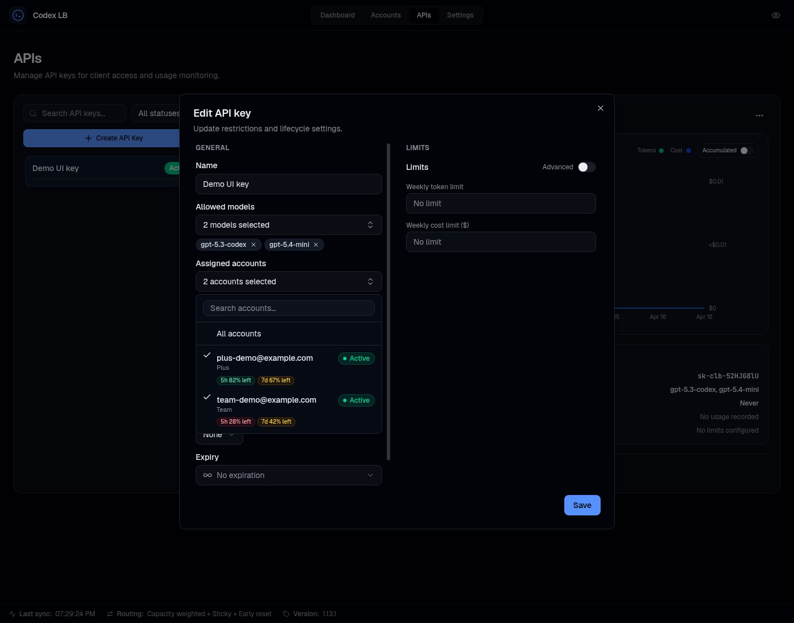

# API Key Authentication

API key auth is **disabled by default**. In that mode, only local requests to the protected proxy routes can
proceed without a key; non-local requests are rejected until proxy authentication is configured. Enable it in
**Settings → API Key Auth** on the dashboard when clients connect remotely or through Docker, VM, or container
networking that appears non-local to the service.

When enabled, clients must pass a valid API key as a Bearer token:

```
Authorization: Bearer sk-clb-...
```

## Protected routes

The protected proxy routes covered by this setting are:

- `/v1/*` (except `/v1/usage`, which always requires a valid key)
- `/backend-api/codex/*`
- `/backend-api/transcribe`

## Creating keys

Dashboard → API Keys → Create. The full key is shown **only once** at creation. Keys support optional expiration, model restrictions, and rate limits (tokens / cost per day / week / month).

Keys can also be scoped to specific accounts, so a key draws quota only from the accounts assigned to it:



## Claude and other model-source accounts

Codex account assignments and model-source assignments are independent. A key's effective source access is the intersection of its source assignment, allowed models, enforced model, billing policy and fresh source eligibility. An explicitly scoped empty source list denies source access; an unrestricted source scope does not bypass model or quota restrictions.

The create/edit model picker retains configured Claude models even while their subscription quota is exhausted. The client catalog and inference continue to exclude/refuse those models until a successful provider observation confirms recovery. Existing key assignments do not need to change when quota recovers, and exhaustion never enables a metered fallback.

The APIs detail panel shows effective model access, observed quota, source cost coverage and native connection instructions. Source identities and quota inventory require **both API keys read and Accounts read**; API-only readers can still inspect key policy and connection instructions. Private inventory reads use `Cache-Control: no-store` and are hidden after authorization loss until a new authorized read succeeds.

Use the gateway key, not an upstream credential, at `POST /v1/messages` and `POST /v1/messages/count_tokens`. Native Anthropic clients may send the gateway key as `x-api-key`; Bearer authentication is also supported. The full key remains available only at creation or regeneration.

## Reasoning effort policies

A key can either enforce one reasoning effort or allow a selected non-empty set of client-requested efforts.
Leave the allowed-efforts selection empty to keep the existing unrestricted behavior. A request that explicitly
sets an effort outside its key's allowlist receives a `403 reasoning_effort_not_allowed` response. Requests that
omit a reasoning effort continue to use the model or upstream default.

The policy evaluates the effort selected by the client, including supported model aliases such as `-xhigh`.
Each configured effort is distinct: allowing `high` does not allow `xhigh`, and allowing `max` does not allow
`ultra`. The proxy still rewrites an allowed `ultra` request to the upstream wire value `max`.


For wiring keys into each client, see [Client Setup](client-setup.md).

---

*Spec: [api-keys](https://github.com/Soju06/codex-lb/tree/main/openspec/specs/api-keys)*
